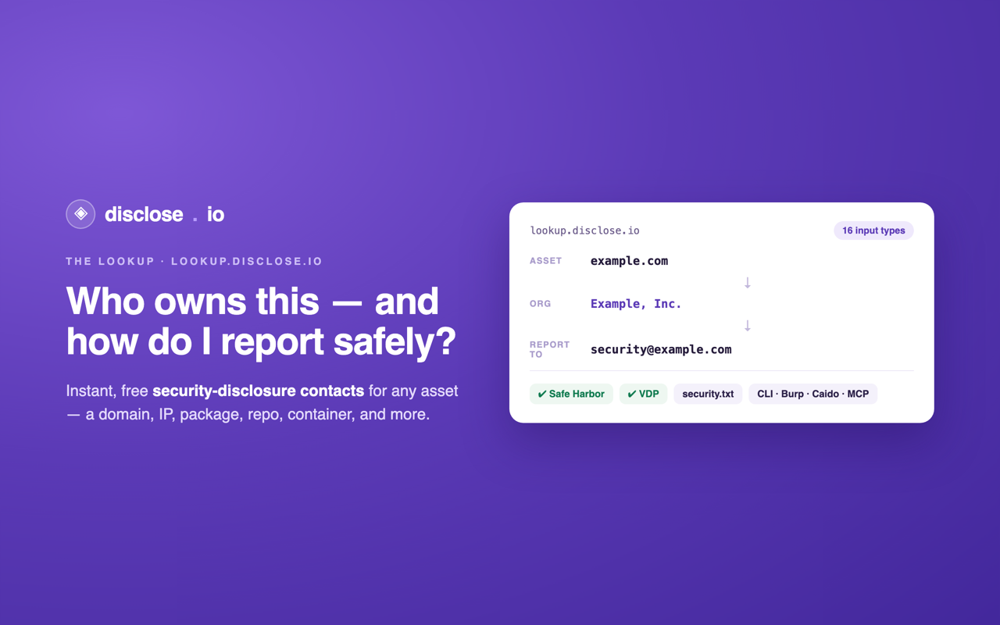

<div align="center">

<a href="https://disclose.io"></a>

# caido-lookup

### Look up a host's **security-disclosure contact** — right inside [Caido](https://caido.io). Powered by [lookup.disclose.io](https://lookup.disclose.io).

<p>
<a href="LICENSE"></a>
<a href="https://lookup.disclose.io"></a>
<a href="https://caido.io"></a>
<a href="https://github.com/disclose/caido-lookup/issues"></a>
</p>

*Part of **[the disclose.io Project](https://disclose.io)** — the open, vendor-neutral infrastructure for vulnerability disclosure. [Browse the ecosystem →](https://github.com/disclose)*

</div>

---


# Disclosure Lookup — a Caido plugin

Look up the **security-disclosure contact for any host** without leaving [Caido](https://caido.io).

Right-click a request (or a row in HTTP History) and choose **Find disclosure contact**. The plugin queries [lookup.disclose.io](https://lookup.disclose.io) and shows you the owning organization, jurisdiction, attribution confidence, and server-ranked route groups — first party, authorized agent, responsible operator, related party, inferred lead, then coordinator — with the legacy flat contact list retained as a fallback.

> A [disclose.io](https://disclose.io) project. The lookup API is free, CORS-open, and unauthenticated — no key or account required.

---

## What it does

- **Context-menu action** — right-click in a request pane or on a request row → **Find disclosure contact**. The plugin resolves the request's host.
- **Sidebar page** — a dedicated *Disclosure Lookup* page that renders the result and also lets you look up any asset manually (domain, IP, URL, email, package, …).
- **Command palette** — the action is also available via the command palette.

The network call runs in the plugin's **backend** (Caido's sandboxed JavaScript runtime), which keeps the egress out of the Caido UI process. The frontend talks to the backend over Caido's typed RPC bridge.

## What this plugin sends

The plugin uses one external service, [lookup.disclose.io](https://lookup.disclose.io), and only when you ask it to (a right-click action, the command palette, or the input box on its page). Nothing runs on load, on navigation, or in the background.

- **Sent:** a single `POST https://lookup.disclose.io/api/lookup` carrying `{ "input": "<asset>" }`, where `<asset>` is the host of the request you right-clicked, or the text you typed. No request body, headers, cookies, response data or project information leaves Caido.
- **Client identifier:** the request carries `User-Agent: caido-lookup/<version>` and an `X-Lookup-Client` header with the same value. disclose.io uses this for aggregate per-client usage counts (how many lookups came from the Caido plugin versus the CLI, the Burp extension and so on). It identifies the plugin, not you or your Caido instance.
- **Stored on your machine:** nothing. The plugin keeps no history and writes no files.
- **Account or payment:** none. The lookup API is free and unauthenticated.

If you need to keep target hostnames inside your own network, do not use this plugin against those targets.

## Architecture

```
caido-lookup/
├── manifest.json              # declares the frontend + backend plugins
├── packages/
│   ├── backend/               # calls lookup.disclose.io, returns parsed result
│   │   └── src/
│   │       ├── index.ts       # sdk.api.register("lookup", …) + fetch POST
│   │       └── types.ts       # API response + result types
│   └── frontend/              # command, context menu, sidebar page, rendering
│       └── src/
│           ├── index.ts       # sdk.commands / sdk.menu / sdk.navigation / sdk.sidebar
│           ├── types.ts       # CaidoSDK typed with the backend API
│           └── styles/style.css
└── scripts/package.mjs        # assembles the installable plugin package zip
```

| Concern | Where | Caido SDK surface |
| --- | --- | --- |
| Right-click action | frontend | `sdk.commands.register`, `sdk.menu.registerItem({ type: "Request" \| "RequestRow" })` |
| Host extraction | frontend | command `CommandContext` → `request.host` / `requests[].host` |
| Sidebar page | frontend | `sdk.navigation.addPage`, `sdk.sidebar.registerItem` |
| Outbound HTTP | backend | global `fetch` (LLRT runtime) → `POST https://lookup.disclose.io/api/lookup` |
| Frontend ↔ backend | both | backend `sdk.api.register` typed by `API`; frontend `sdk.backend.lookup(host)` |

## Build

The plugin is built with [Vite](https://vitejs.dev/), the build tool used by the official Caido starter kit. You need Node 18+ and `npm` (or `pnpm`).

```bash
# install dependencies
npm install

# typecheck (optional)
npm run typecheck

# build both packages and assemble the plugin package
npm run build
```

This produces:

- `dist/frontend/script.js` + `dist/frontend/style.css`
- `dist/backend/script.js`
- `dist/manifest.json`
- **`plugin_package.zip`** ← the installable plugin package (root of the repo)

## Install in Caido

**From the Community Store (recommended):**

1. In Caido, open **Plugins** → **Community Store**.
2. Find **Disclosure Lookup** and click **Install**.
3. A **Disclosure Lookup** entry appears in the left sidebar.

Store installs are signed releases: Caido verifies each release against the public key registered for this plugin in [`caido/store`](https://github.com/caido/store/blob/main/plugin_packages.json), and new versions appear in the store automatically when a release is published here.

**From a package file:**

1. Download `plugin_package.zip` from the [latest release](https://github.com/disclose/caido-lookup/releases/latest), or build it yourself with `npm install && npm run build`.
2. In Caido, open **Plugins** → **Installed** → **Install Package**.
3. Select `plugin_package.zip`.

> Plugins installed from a local package are treated as unsigned. Caido will prompt you to confirm the install. See *Releasing to the Caido store* below for how signed releases are produced.

## Usage

- **From a request:** right-click in a request pane, or on a row in **HTTP History**, and choose **Find disclosure contact**. The Disclosure Lookup page opens with the result for that host.
- **Manually:** open the **Disclosure Lookup** sidebar page and type any asset (domain, IP, URL, email, package, repository, …) into the input box.

Route groups stay in the API's authoritative order so the UI never promotes a
generic or coordinator contact above an owner route. Each contact is tagged:

- **verified** — derived from an authoritative source (`security.txt`, `SECURITY.md`, DioDB, PSIRT directories).
- **unverified** — a heuristic guess (e.g. the `security@` / `abuse@` convention). Confirm before relying on it.

## Releasing to the Caido store

This plugin is listed in the [Caido Community Store](https://github.com/caido/store) as `caido-lookup` (added in [caido/store#98](https://github.com/caido/store/pull/98), July 2026). The store reads this repository's GitHub releases, so publishing a new version is a release here, not a new store submission. Maintainer steps:

1. **Bump the version** in `manifest.json`, the root `package.json`, and `CLIENT_ID` in `packages/backend/src/index.ts`. All three must match. The release tag is the bare manifest version (for example `0.2.1`, no `v`), and the store rejects a release whose tag and manifest version differ.
2. **Merge to `main`**, then run the **Release** workflow from the Actions tab (`workflow_dispatch`). It builds `plugin_package.zip`, signs it with the Ed25519 `PRIVATE_KEY` repository secret, and publishes an **immutable** GitHub release with exactly `plugin_package.zip` and `plugin_package.zip.sig` attached.
3. **Check the release** shows as immutable with both assets. Immutable releases cannot be edited or deleted, and a deleted tag can never be reused, so the version bump in step 1 has to be right the first time.
4. Caido picks the new release up automatically; users see the update in **Plugins** → **Community Store**.

The signing key pair is one per plugin. The public half is registered in `plugin_packages.json`; the private half lives only in the `PRIVATE_KEY` Actions secret and is excluded from git by `.gitignore` (`*.pem`, `*.sig`).

Full reference: the Caido [*Submit to Store*](https://developer.caido.io/plugins/guides/store.html) and [*Set Up Repository*](https://developer.caido.io/plugins/guides/repository.html) guides, and the [Developer Policy](https://developer.caido.io/policy.html).

## License

[MIT](./LICENSE) © disclose.io
